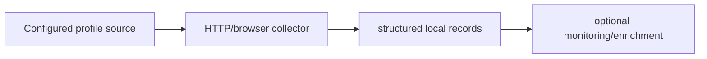

# Social Profile Collector

**HTTP/browser collection, structured social records and optional chain enrichment.**

  [](LICENSE)

[Overview](#overview) · [Quickstart](#quickstart) · [Example](#example) · [Validation](#validation) · [Documentation](#documentation)

## Overview

A Python collection and monitoring toolkit combining profile/API parsing, browser automation and optional on-chain enrichment.

**Stack:** Python · requests · BeautifulSoup · lxml · Selenium · websocket-client

## Select a collector for the delivery mode

| Component | Behavior |
| --- | --- |
| HTTP | requests/BeautifulSoup/lxml paths parse directly delivered content. |
| Browser | Selenium handles browser-dependent collection paths. |
| Enrichment | Optional chain and notification scripts extend collected observations. |

## Processing path



## Quickstart

```console
python -m venv .venv
# Activate .venv, then:
python -m pip install -r requirements.txt
python -m py_compile moltx_scraper.py moltx_browser_scraper.py extrair_dados.py
```

The commands above install prerequisites or run the specified offline checks. Live collection, cloud operations, messaging and trading are separate operational steps when present.

## Example

**Inspect the workflow**

Use [the usage guide](docs/usage.md) to identify the appropriate collector. Inspect parser inputs and local JSON/HTML outputs before configuring a source. Browser state, downloaded profile snapshots and optional notification/chain enrichment are separate from the parser contract.

## Configuration and storage

Python requirements are listed in [requirements.txt](requirements.txt). Selenium needs a separate browser runtime. [.env.example](.env.example) names optional Telegram and RPC configuration without distributing sessions.

## Repository guide

| Location | Responsibility |
| --- | --- |
| [moltx_scraper.py](moltx_scraper.py) | HTTP collection |
| [moltx_browser_scraper.py](moltx_browser_scraper.py) | Browser collection |
| [extrair_dados.py](extrair_dados.py) | Structured extraction |
| [docs/usage.md](docs/usage.md) | Installation and commands |

## Validation

The quickstart lists the declared checks. No passing CI or coverage claim is implied by the technology badges.

## Scope and operational boundaries

Source-specific scripts retain investigation defaults and live connectivity paths. Syntax checks do not validate current selectors or authenticated source access. Keep browser profiles and private records outside the repository.

## Documentation

- [Installation and commands](docs/usage.md)

## License and attribution

Project-authored source code is licensed under the [MIT License](LICENSE). Third-party components and datasets retain their respective rights and licenses.
